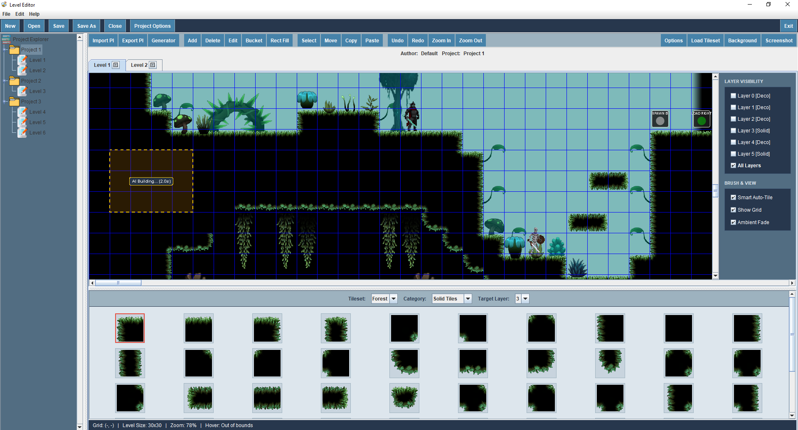
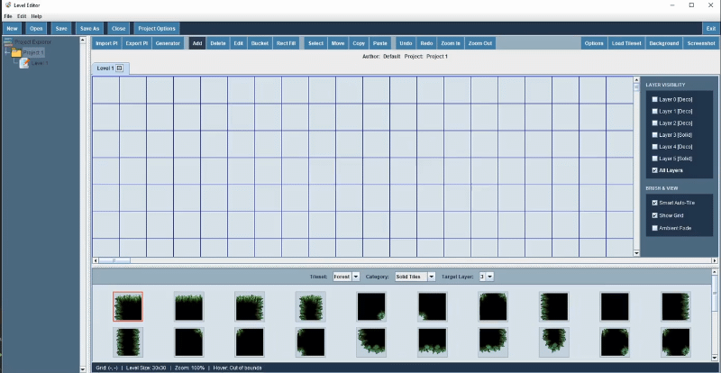
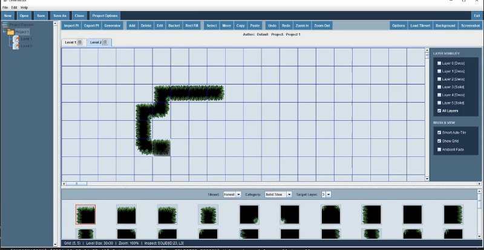
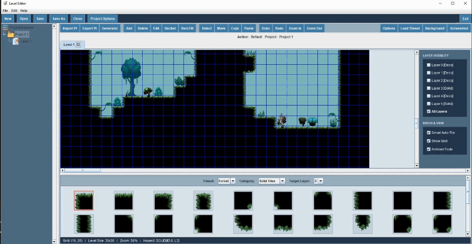
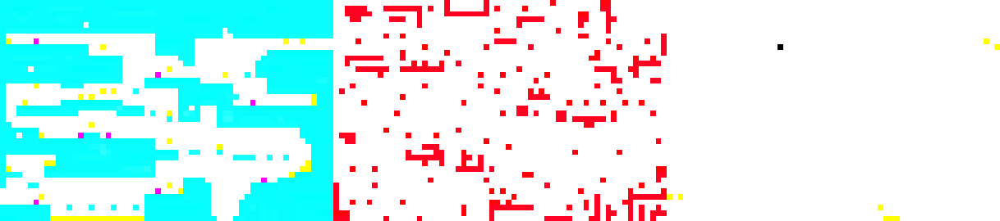

# Merciless Warrior - Level Editor

## Overview

This is the dedicated level editor built for **Merciless Warrior**, a 2D action platformer written in Java.

Initially, I considered using a general-purpose tool, but Merciless Warrior relies on a custom 3-panel RGB pixel format, specific multi-layer rendering rules, and custom entity/trigger bindings. Building a dedicated editor in allowed me to match the game's exact rendering pipeline, automate auto-tiling, validate platforming jump physics, and integrate an async AI co-pilot directly into the level design workflow.

## Table of Contents

- [Key Features](#key-features)
    - [Smart Painting & Auto-Tiling](#1-smart-painting--auto-tiling)
    - [Asynchronous Co-Op AI Inpainting](#2-asynchronous-co-op-ai-inpainting)
    - [Procedural Generation & Jump Validation](#3-procedural-generation--jump-validation)
    - [Multi-Layer Rendering & Subterranean Cutaways](#4-multi-layer-rendering--subterranean-cutaways)
- [3-Panel RGB Pixel Format](#3-panel-rgb-pixel-format)
- [Controls & Keyboard Shortcuts](#controls--keyboard-shortcuts)
- [License](#license)

---

## Key Features

### 1. Smart Painting & Auto-Tiling

Drawing cave and forest geometry by hand usually takes a lot of time when you have to manually pick outer corners, inner concave corners, T-junctions, and 1-tile bridge caps.

* **Real-time auto-tiler:** When **Smart Auto-Tile** is enabled in the side panel, painting or erasing automatically checks all 8 neighbors (cardinal + diagonal) and updates the surrounding tile edges in real time.
* **Flood fill & rectangle fill:** Fill enclosed areas with the **Bucket** tool, or drag a box with **Rect Fill** to build (or hold `Shift` to erase) large terrain sections at once.
* **Ghost cursor previews & eyedropper:** Hovering over the grid renders a translucent preview of the selected tile, multi-tile decoration (with its true pixel offsets), or copied clipboard group before you click. Holding `Alt + Left-Click` (or `Middle-Click`) picks any tile from the canvas directly into your active brush.
* **Stroke-based undo/redo:** Continuous mouse drag strokes, multi-tile moves, and region edits are grouped into atomic commands with independent undo/redo stacks per tab.

<!-- Replace with your recorded GIF of Smart Brush + Rect Fill -->

  
  

---

### 2. Asynchronous Co-Op AI Inpainting

Instead of only generating full levels from scratch and overwriting manual work, the editor includes a non-blocking **Co-Op AI** mode powered by the Gemini API.

1. Use the **Select** tool to drag a rectangle over any part of your level.
2. Open the **Generator** dialog, type what you want in that specific region (for example: *"connect these two cliffs with a flat floor and add two trees and a crate"* or *"make a subterranean cavern with a boulder and glowing mushrooms"*), and click **Co-Op AI**.
3. The dialog closes immediately and locks **only** that rectangle with an animated overlay.
4. While the background worker thread sends the panel context to Gemini and computes the new nodes off-thread, you can continue painting, decorating, or even launching a second AI worker on another part of the map.
5. When the worker finishes, it patches only that rectangle on the Swing EDT via `RegionPatchCommand` and stitches the 1-tile perimeter seam with the auto-tiler. Pressing `Ctrl+Z` undoes the AI patch without touching anything you drew outside the box.

<!-- Replace with your recorded GIF of Co-Op AI running while you draw elsewhere -->

  

---

### 3. Procedural Generation & Jump Validation

For rapid prototyping without an internet connection or API key, the editor includes an offline procedural generator with five room archetypes:

* **True Random Cave & Cliffs:** Uses 2D multi-octave Perlin/value noise, drunkard's walk tunnelers, cellular automata smoothing, and hidden destructible-brick loot alcoves.
* **Physics-aware playability validator (`PlayabilityValidator`):** After carving a room, the validator runs a Breadth-First Search (BFS) over standable floor tiles using the player's actual jump constraints (`max jump height = 3 tiles`, `max jump distance = 4 tiles`, plus 2-tile hitbox headroom checks along parabolic arcs). If the exit or an upper ledge is unreachable, it automatically builds staggered stepping platforms to guarantee the room is beatable.
* **Full auto-decorator (`AutoDecoratorEngine`):** Populates floors, walls, and ceilings with trees, stone pillars, boulders, bushes, flowers, logs, glowing mushrooms, crystals, and hanging vines while checking sprite footprints and avoiding spike/lava hazards.

<!-- Replace with your recorded GIF of Procedural Generation + Export Preview -->

  

---

### 4. Multi-Layer Rendering & Subterranean Cutaways

The editor uses Z-layering:

| Layer | Category | Purpose in Game Engine |
| :--- | :--- | :--- |
| **Layer 0, 1, 2** | Decorations | Background props rendered behind solid terrain (trees, pillars, boulders, border fade caps, and black cavern backing `34:2`). |
| **Layer 3** | Solid Tiles | Primary playable collision terrain (floors, walls, ceilings, floating bridges). |
| **Layer 4** | Decorations | Foreground grass and props placed inside subterranean wall pockets. |
| **Layer 5** | Solid / Entities | Subterranean background caverns/hills (`R:255:255`), interactive objects, enemies, player spawn, triggers, and NPCs. |

---

## 3-Panel RGB Pixel Format

To keep level files tiny and fast to parse in the game engine, levels are exported as a single composite PNG (`width * 3` by `height`) alongside an optional `.json` metadata file.

### 1. Composite PNG Layout

| Panel | X Range | Element Type | Red (`R`)                                                | Green (`G`)                                                      | Blue (`B`)                                                        |
| :--- | :--- | :--- |:---------------------------------------------------------|:-----------------------------------------------------------------|:------------------------------------------------------------------|
| **Panel 1 (Left)** Physical World | `0 .. W-1` | Solid Terrain (Layer 3) Subterranean Solid (Layer 5) Enemy Spawn Interactive Object Player Spawn Empty Air | `0 .. K` `0 .. K` `254` `254` `100` `254` | `254` `255` `0 .. E` (Enemy ID) `254` `100` `254` | `254` `255` `254` `0 .. P` (Object ID) `100` `254` |
| **Panel 2 (Middle)** Decorations | `W .. 2W-1` | Decoration Sprite | `254`                                                    | `0, 1, 2, 4` (Z-Layer)                                           | `0 .. D` (Deco ID)                                                |
| **Panel 3 (Right)** Logic & NPCs | `2W .. 3W-1` | Spatial Trigger NPC Spawn | `254` `0`                                             | `254` `0`                                                     | `0 .. T` (Trigger ID) `0 .. N` (NPC ID)                        |

### 2. Companion Metadata

While the PNG stores grid coordinates, tile IDs, and layers, the exported `.json` file stores floating-point transformation data (custom rotation angles and X/Y scale multipliers) for any decorations modified with the **Edit** tool, as well as level background IDs and point lights.

---

## Controls & Keyboard Shortcuts

| Input / Shortcut | Action |
| :--- | :--- |
| `Left-Click / Drag` | Use active tool (Add, Delete, Select, Move, Bucket, Rect Fill) |
| `Right-Click + Drag` | Pan around the level canvas |
| `Alt + Left-Click` or `Middle-Click` | **Eyedropper:** Pick tile, category, and layer from canvas |
| `Ctrl + Mouse Wheel` | Zoom in / Zoom out (`30%` to `300%`) |
| `Mouse Wheel` / `Shift + Wheel` | Scroll vertically / Scroll horizontally |
| `Ctrl + Z` / `Ctrl + Y` | Undo / Redo (per level tab) |
| `Ctrl + C` / `Ctrl + V` | Copy selected tiles / Enter Paste mode |
| `Shift + Drag` (in **Select** tool) | Add to current tile selection |
| `Shift + Drag` (in **Rect Fill** tool) | Erase all tiles inside the dragged box |
| `Ctrl + G` | Toggle grid visibility |
| `Ctrl + N` / `Ctrl + O` / `Ctrl + S` | New project or level / Open project / Save project |
| `Ctrl + R` | Open Project & Level Options (rename, stats, duplicate, batch export) |
| `F1` | Open in-app Help & RGB Encoding reference guide |

---

## License

This project is licensed under the [MIT License](LICENSE).